<p align="center">
  <a href="https://ruvelo.github.io/laravel-feedback/">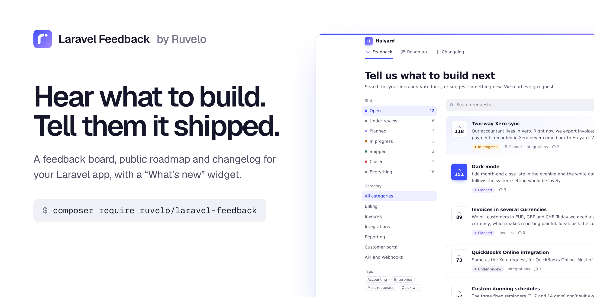</a>
</p>

<p align="center">
  <a href="https://ruvelo.github.io/laravel-feedback/"><strong>Live demo</strong></a> &nbsp;&nbsp;&nbsp;
  <a href="#configuration"><strong>Configuration</strong></a> &nbsp;&nbsp;&nbsp;
  <a href="#for-developers"><strong>Developer guide</strong></a> &nbsp;&nbsp;&nbsp;
  <a href="CHANGELOG.md"><strong>Changelog</strong></a>
</p>

<p align="center">
  <a href="https://github.com/Ruvelo/laravel-feedback/actions/workflows/tests.yml"></a>
  
  
  
  <a href="LICENSE"></a>
</p>

# Laravel Feedback

**A feedback board, public roadmap and changelog that mount into any Laravel app.** Your users ask for things and vote, you plan and build, and when it ships they're told, in their inbox and by email. The loop that Canny, Featurebase and Beamer sell as a subscription, as one free package that lives in your own app and database.

```
composer require ruvelo/laravel-feedback
php artisan migrate
```

Open `/feedback`. Define a `feedback-manage` gate to let your team in, and drop `<x-feedback::whats-new />` into your app's header. Or click around the [live demo](https://ruvelo.github.io/laravel-feedback/) first.

## A quick tour

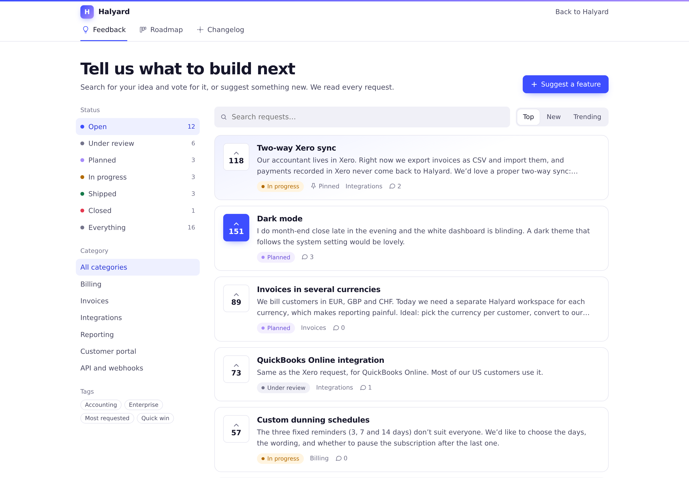

**A board people actually use.** Requests with one-click votes, filtered by status, category and tag, sorted by top, new or trending. Pinned requests stay on top. Guests can read everything; voting and posting need a sign-in.

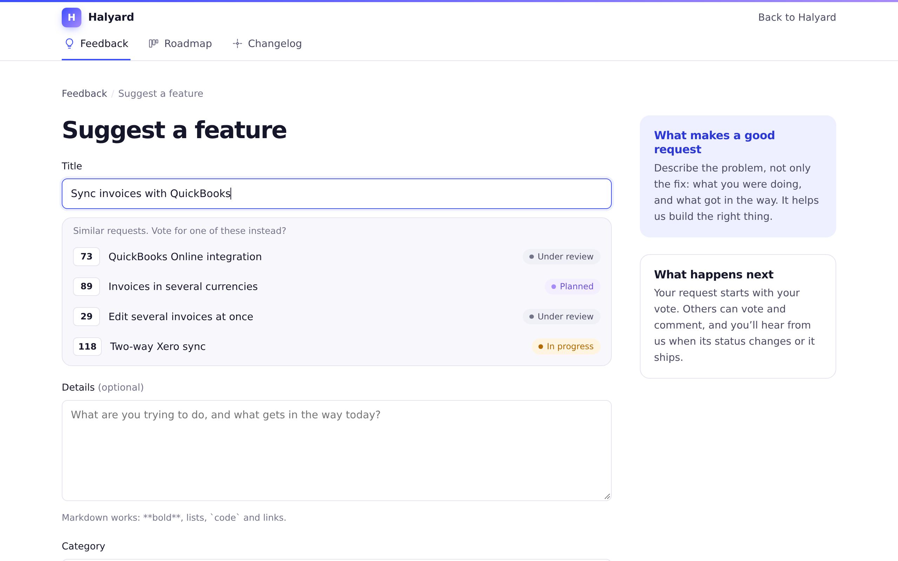

**Fewer duplicates.** While someone types a title, similar requests appear with their votes, so they vote instead of posting the same idea again. When duplicates slip through, merge them: votes carry over and nobody is counted twice.

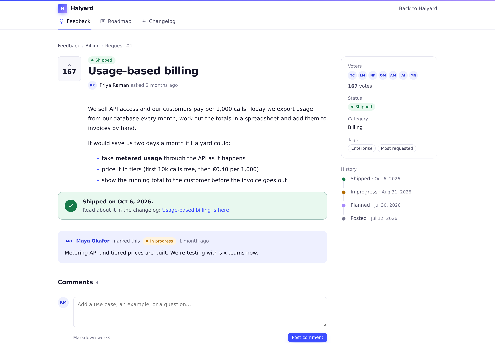

**Every request tells its story.** Status history, the team's public notes, threaded comments with Markdown (team replies are marked), and a link to the changelog entry it shipped in.

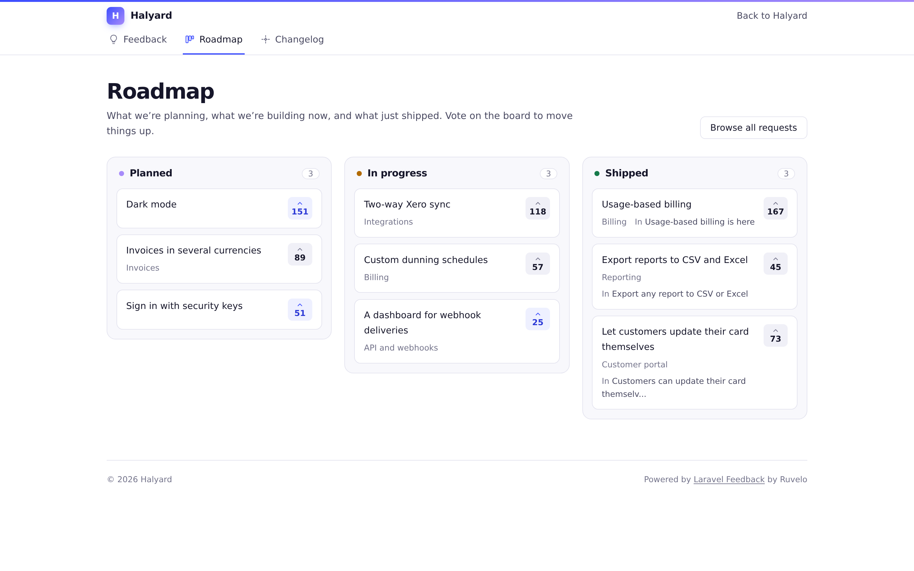

**A public roadmap** of what's planned, in progress and shipped, straight from the board. Columns on desktop, stacked on phones.

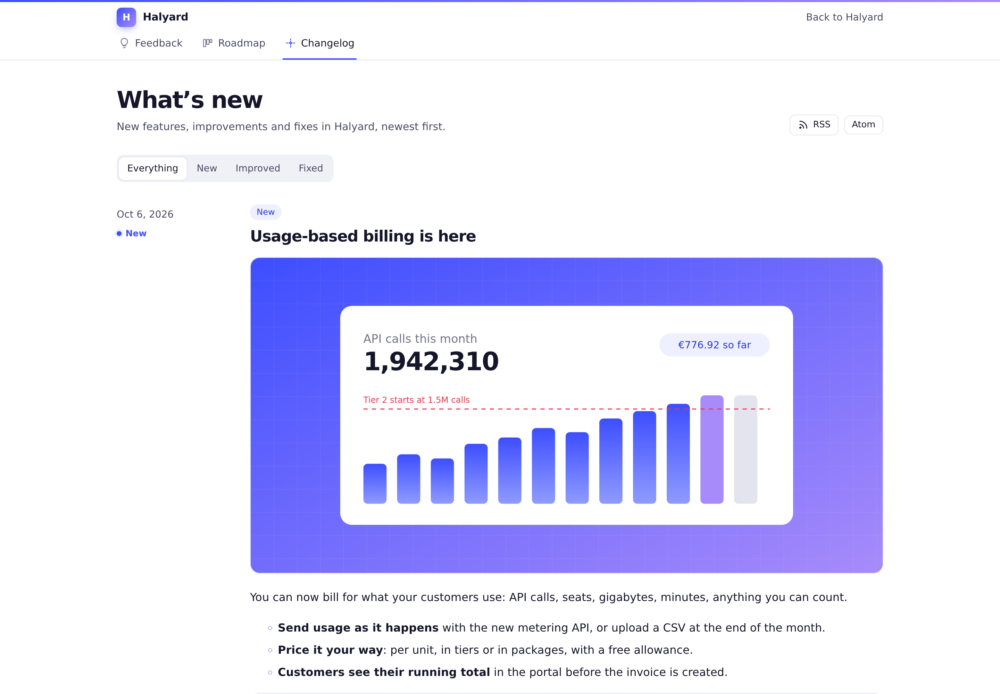

**A changelog with feeds.** Markdown entries with labels (New, Improved, Fixed), cover images, and the requests they answer. RSS and Atom included.

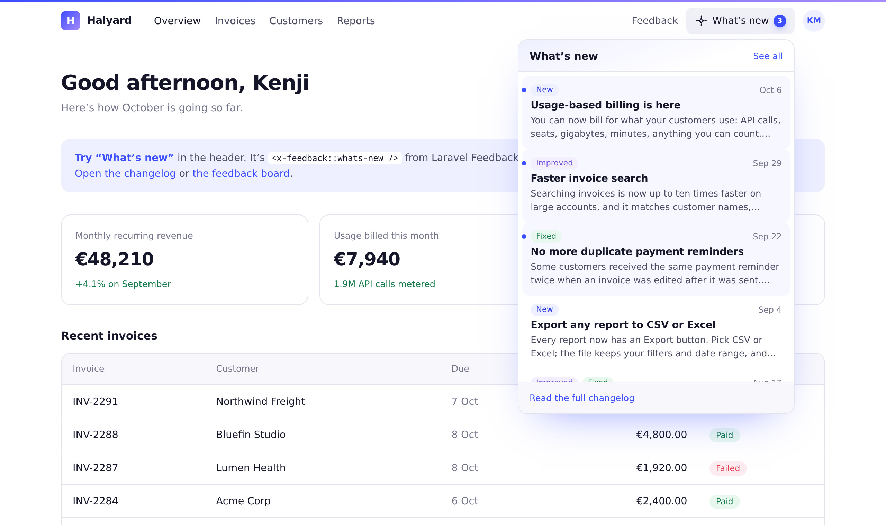

**"What's new" in your app.** `<x-feedback::whats-new />` shows how many updates each user hasn't seen and a dropdown of the latest. Without JavaScript it's a link to the changelog.

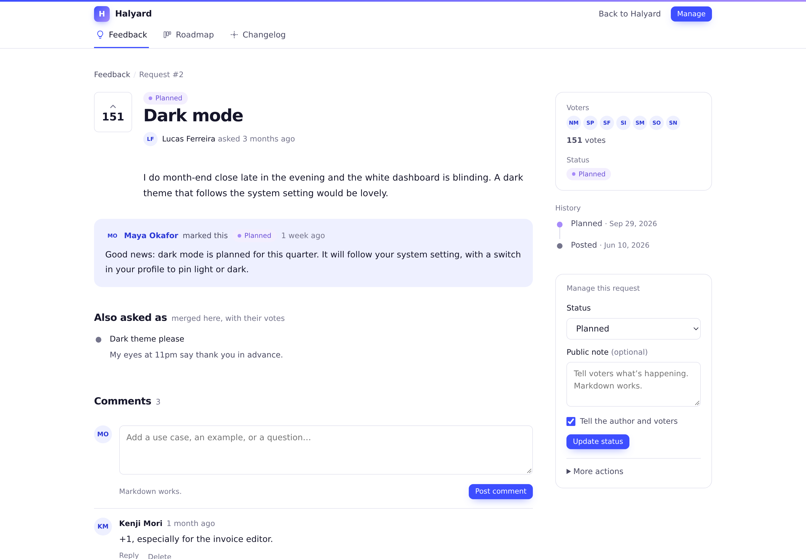

**Close the loop.** Change a status with a public note, or publish a changelog entry that ships the linked requests: the author and every voter get a Laravel notification (database and mail). Its `title`, `body` and `url` show up in [ruvelo/laravel-inbox](https://github.com/Ruvelo/laravel-inbox) with no setup.

<table>
  <tr>
    <td width="50%">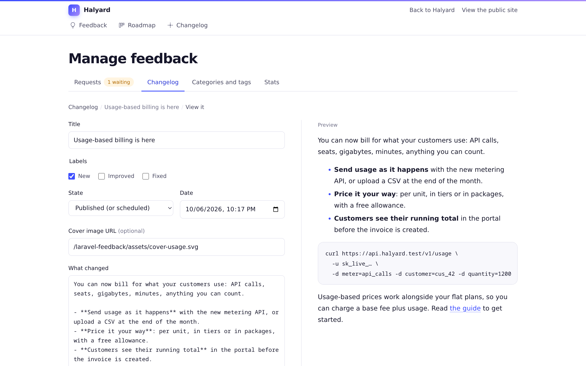</td>
    <td width="50%">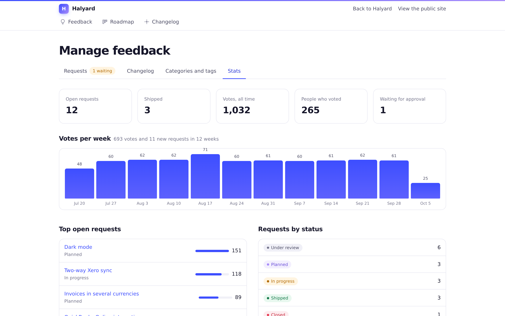</td>
  </tr>
  <tr>
    <td><strong>A changelog editor</strong> with live preview, labels, scheduling and the requests it ships.</td>
    <td><strong>Simple stats</strong>: votes per week, top open requests, requests by status.</td>
  </tr>
  <tr>
    <td width="50%">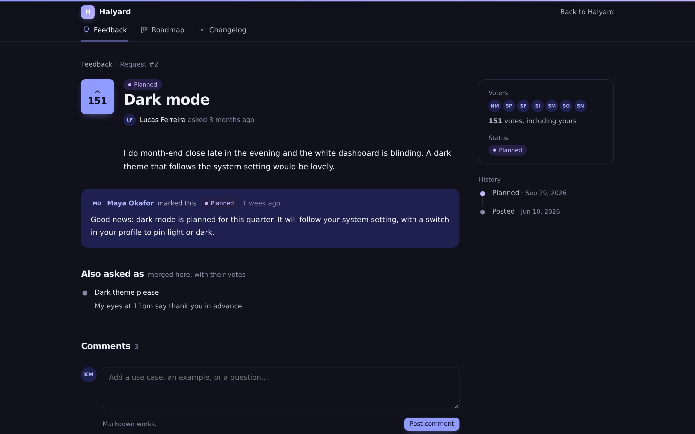</td>
    <td width="50%">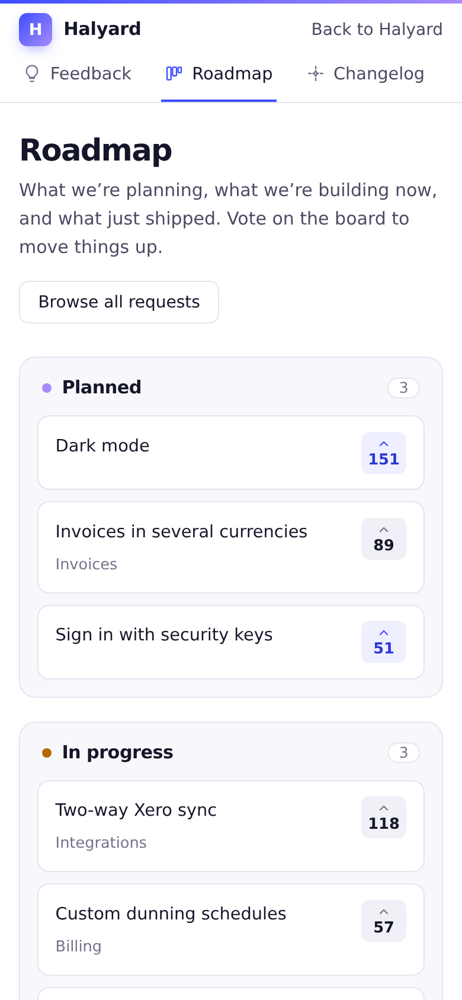</td>
  </tr>
  <tr>
    <td><strong>Light and dark</strong>, following each visitor's system setting.</td>
    <td><strong>Mobile first</strong>, down to 360px.</td>
  </tr>
</table>

## Features

- **Feedback board**: requests with a title and Markdown description, one vote per person (enforced by a unique index), categories and tags, filters, search, and top, new and trending sorts. Pin what matters.
- **Similar requests** as you type a title, and **merging** that carries votes and comments over.
- **Statuses**: Under review, Planned, In progress, Shipped and Closed, with your own labels and colours, or extra statuses of your own. Shipped and closed requests stop taking votes.
- **Comments**: simple threads with replies and Markdown, or [ruvelo/laravel-comments](https://github.com/Ruvelo/laravel-comments) (reactions, mentions, moderation) when it's installed.
- **Public roadmap**: your planned, in-progress and shipped requests as columns.
- **Changelog**: Markdown entries with labels, cover images, drafts and scheduling, linked requests, RSS and Atom feeds.
- **"What's new" widget**: an unread badge per user (a last-seen time; a cookie for guests) and a dropdown of recent entries.
- **Notifications** for authors and voters when a request changes status or ships, through any Laravel channels.
- **Admin area**: an approval queue (optional), status changes with public notes, merging, editing, categories and tags, the changelog editor and stats.
- **Safe by default**: everything escaped, raw HTML in Markdown escaped, `javascript:` links dropped, images in user posts turned into links. Rate limits and a honeypot on every public write. Guests trying to write go to your `login` route, or get a 403: never a 500.
- **Works without JavaScript**, and gets better with it: votes, similar requests, replies and the editor preview happen in place.
- **For developers**: a typed PHP API, events for every change, typed exceptions, factories, a JSON API, and [Laravel Boost](https://laravel.com/docs/boost) guidelines.
- **Ruvelo house style**: scoped styles that never leak into your app, themable with CSS variables, or rendered inside your own layout.

## Requirements

- PHP 8.3+
- Laravel 12 or 13
- Any database Laravel supports (tested on SQLite)

## Getting started

**1. Install and migrate**, as above. The board is at `/feedback`, the roadmap at `/feedback/roadmap` and the changelog at `/feedback/changelog`.

**2. Let your team manage it.** Nobody can until you define the gate, for example in your `AppServiceProvider`:

```php
use Illuminate\Support\Facades\Gate;

Gate::define('feedback-manage', fn ($user) => $user->is_admin);
```

Managers see a **Manage** button, a panel on every request, and the admin area at `/feedback/manage`.

**3. Notifications.** When a request changes status, its author and voters get a `RequestStatusChanged` notification through the `database` and `mail` channels. Your user model needs the `Notifiable` trait, and the database channel needs the notifications table (`php artisan make:notifications-table && php artisan migrate`); until it exists, that channel is skipped.

**4. Add "What's new" to your header:**

```blade
<header>
    …
    <a href="{{ route('feedback.home') }}">Feedback</a>
    <x-feedback::whats-new />
</header>
```

It brings its own styles and script, once per page. Options: `:limit="3"`, `label="Updates"`, `data-theme="light"` for a light-only app.

## Who can do what

| Gate | Arguments | Default |
|---|---|---|
| `feedback-manage` | `$user` | Nobody, until you define it |
| `feedback-post` | `$user` | Any signed-in user |
| `feedback-vote` | `$user, $request` | Any signed-in user |
| `feedback-comment` | `$user, $request` | Any signed-in user |

Define a gate with the same name to decide yourself, e.g. `Gate::define('feedback-post', fn ($user) => $user->hasVerifiedEmail())`. Comments can be deleted by their author or a manager.

## Configuration

Publish the config file to change the defaults:

```
php artisan vendor:publish --tag=feedback-config
```

| Key | Default | |
|---|---|---|
| `name` | `APP_NAME` (`FEEDBACK_NAME`) | Shown in the header, titles and feeds |
| `sections.board` / `.roadmap` / `.changelog` | `true` | Switch a section off: its routes and tab go away |
| `path` | `feedback` (`FEEDBACK_PATH`) | URL prefix for everything |
| `domain` | `null` | Serve it on another (sub)domain |
| `middleware` | `['web']` | Every route. Add `auth` to make the whole portal private |
| `manage_middleware` | `[]` | Added to the admin area, on top of the gate |
| `routes` | `true` | Set to `false` to register routes yourself (copy `routes/web.php`) |
| `layout` / `section` | `null` / `content` | Your layout view, and the section the pages fill. `null` uses the package's page |
| `app.label` / `app.url` | `null` | A link back to your app in the header |
| `statuses` | five built-in | Key ⇒ `label` and `color` (`accent`, `lilac`, `success`, `warning`, `danger`, `neutral`, or a hex colour). Keep the built-in keys; add your own |
| `open_statuses` | under review, planned, in progress | The board's default filter |
| `locked_statuses` | shipped, closed | No new votes in these |
| `board.sort` | `top` | Default sort: `top`, `new` or `trending` |
| `board.trending_days` | `14` | What "trending" counts |
| `board.per_page` | `20` | Requests per page |
| `board.require_approval` | `false` | Hold new requests for a manager |
| `board.similar` | `5` | How many similar requests to suggest |
| `roadmap.statuses` / `.limit` | planned, in progress, shipped / `20` | The roadmap's columns and their length |
| `changelog.labels` | New, Improved, Fixed | Key ⇒ `label` and `color` |
| `changelog.per_page` / `.feed` | `10` / `20` | Entries per page and in the feeds |
| `widget.limit` / `.fresh_days` | `5` / `30` | Entries in the dropdown; what counts as new for someone who never looked |
| `comments.driver` | `auto` (`FEEDBACK_COMMENTS`) | `builtin`, `ruvelo` (ruvelo/laravel-comments), `auto` (ruvelo when installed), or `null` for none |
| `notifications.enabled` | `true` (`FEEDBACK_NOTIFICATIONS`) | Tell authors and voters about status changes |
| `notifications.channels` | `['database', 'mail']` | Any Laravel channels |
| `notifications.statuses` | `null` | Only notify for these statuses; `null` for all |
| `rate_limits.requests` / `.comments` / `.votes` | `5` / `10` / `60` | Per user per minute, through the routes. `null` turns one off |
| `honeypot` | `website` | Hidden field name; posts that fill it are dropped. `null` turns it off |
| `max_length.title` / `.body` / `.comment` | `160` / `10000` / `5000` | Characters |
| `name_attribute` | `name` | The user attribute shown as a name |
| `api.enabled` | `false` (`FEEDBACK_API`) | Turn on the JSON API |
| `api.prefix` / `.middleware` / `.write_middleware` | `api/feedback` / `['api']` / `['auth:sanctum']` | Where it lives and how writes authenticate |
| `markdown.extensions` / `.options` | `[]` | Extra CommonMark extensions and options. `html_input` and `allow_unsafe_links` can't be loosened |
| `table_prefix` | `feedback_` | Tables: requests, votes, comments, status_changes, categories, tags, request_tag, entries, seen |
| `run_migrations` | `true` | Set to `false` if you publish and run the migration yourself (`--tag=feedback-migrations`) |

## Making it look like your app

The pages and the widget are styled with CSS variables, scoped to `.fb` and `.fb-wn`. Override any of them:

```css
.fb, .fb-wn { --feedback-accent: #0f766e; --feedback-accent-soft: #e6f4f1; --feedback-radius: 4px; --feedback-sans: Inter, sans-serif; }
```

To render the portal inside your app's chrome, set `layout` to your layout view: the pages fill its `content` section (or whichever you name in `section`) and push their meta tags to a `feedback-head` stack if your layout has one.

For deeper changes, publish the views (`php artisan vendor:publish --tag=feedback-views`). They land in `resources/views/vendor/feedback`: the board, request, roadmap and changelog pages, the admin area in `manage/`, the widget in `components/whats-new.blade.php`, and the `partials/` they're built from.

## For developers

### PHP API

`Ruvelo\Feedback\Feedback` is the one write path: the routes use it too, so counts stay right and events fire.

```php
use Ruvelo\Feedback\Feedback;

$request = Feedback::post($user, 'Dark mode', 'For **late** nights', category: 'Billing', tags: ['Enterprise']);
Feedback::vote($request, $other);            // true when added, false if they'd already voted
Feedback::unvote($request, $other);
Feedback::toggleVote($request, $other);      // whether they're voting now
Feedback::comment($request, $user, 'Me too', parent: $comment);
Feedback::changeStatus($request, 'planned', 'Starting in March.', by: $admin);   // notifies, unless notify: false
Feedback::ship($request, $entry, by: $admin);
Feedback::merge($duplicate, into: $request, by: $admin);
Feedback::pin($request);
Feedback::update($request, ['title' => 'Dark theme', 'tags' => ['Quick win']]);
Feedback::approve($request);
Feedback::delete($request);

$entry = Feedback::publish('Dark mode is here', $markdown, ['new'], coverUrl: $url, requests: [$request]);
Feedback::saveEntry($entry, ['published_at' => null]);   // back to draft

Feedback::requests($viewer)->where('status', 'planned')->get();   // what $viewer may see
Feedback::similar('dark theme');
Feedback::roadmap();                         // ['planned' => Collection, …]
Feedback::changelog()->limit(5)->get();
Feedback::unreadCount($user);
Feedback::markSeen($user);
Feedback::stats();
Feedback::allows('feedback-vote', $user, $request);
Feedback::render('**Markdown**');            // the same safe HTML requests get
```

The PHP API doesn't check gates or rate limits, so imports and seeders aren't slowed down. Call `Feedback::allows()` (or `authorize()`, which throws `NotAllowed`) when acting for a user.

### JSON API

Off by default: set `FEEDBACK_API=true`. Reads are public and only show what the caller may see. Writes need `write_middleware` (Sanctum by default; use `['web']` for both `middleware` and `write_middleware` to rely on the session in an Inertia or Livewire app on the same domain). The web routes answer JSON too when asked (`Accept: application/json`), which is how the vote buttons work.

| Request | Who | Does |
|---|---|---|
| `GET /api/feedback/requests?status=&category=&tag=&q=&sort=&per_page=` | Anyone | The board, paginated |
| `GET /api/feedback/requests/{id}` | Anyone | One request with its `history` |
| `GET /api/feedback/requests/similar?q=` | Anyone | Similar requests |
| `GET /api/feedback/requests/{id}/comments` | Anyone | Comments with nested `replies` (built-in comments) |
| `GET /api/feedback/roadmap` | Anyone | Columns of requests |
| `GET /api/feedback/statuses`, `/categories`, `/tags` | Anyone | For filters |
| `GET /api/feedback/changelog?label=` | Anyone | Published entries |
| `GET /api/feedback/changelog/{slug}` | Anyone | One entry with its `requests` |
| `GET /api/feedback/changelog/whats-new?limit=&since=` | Anyone | `unread` and the latest `entries`, for your own widget |
| `POST /api/feedback/requests` | Signed in | Post `{title, body?, category?}` |
| `POST` / `DELETE /api/feedback/requests/{id}/vote` | Signed in | Vote / take it back. Returns `voted` and `votes` |
| `POST /api/feedback/requests/{id}/comments` | Signed in | Comment `{body, parent_id?}` |
| `POST /api/feedback/changelog/seen` | Signed in | Mark the changelog as seen |
| `PATCH /api/feedback/requests/{id}` | Managers | `{title?, body?, category?, tags?, status?, note?, notify?, entry?, pinned?}` |
| `POST /api/feedback/requests/{id}/merge` | Managers | `{into}` |
| `POST /api/feedback/requests/{id}/approve`, `DELETE …/{id}` | Managers | Approve, delete |
| `POST /api/feedback/changelog`, `PATCH` / `DELETE …/{id}` | Managers | Write entries `{title, body, labels, cover_url, published_at, requests, notify}` |

A request looks like this:

```json
{
  "id": 3, "title": "Usage-based billing", "slug": "usage-based-billing",
  "body": "We sell API access…", "html": "<p>We sell API access…</p>\n", "excerpt": "We sell API access…",
  "status": "shipped", "status_label": "Shipped", "status_note": null, "status_changed_at": "2026-10-06T09:12:00+00:00",
  "votes": 167, "comments": 4, "voted": true, "pinned": false, "approved": true, "locked": true,
  "author": { "name": "Priya Raman", "initials": "PR" },
  "category": { "name": "Billing", "slug": "billing" }, "tags": [{ "name": "Enterprise", "slug": "enterprise" }],
  "entry": { "title": "Usage-based billing is here", "url": "https://app.test/feedback/changelog/usage-based-billing-is-here" },
  "merged_into": null, "url": "https://app.test/feedback/requests/3-usage-based-billing",
  "created_at": "2026-07-12T10:00:00+00:00",
  "can": { "vote": false, "comment": true, "manage": false }
}
```

Errors are JSON: `401` for guests, `403` when a gate says no, `404` for what the caller can't see, `409` when voting is closed, `422` for validation (with `errors`), `429` when rate limited.

### Events

All in `Ruvelo\Feedback\Events`:

| Event | When |
|---|---|
| `RequestPosted` | A request is posted (check `$request->isApproved()`) |
| `RequestApproved` | A manager approves a waiting request |
| `RequestUpdated` | A manager edits it; `$changes` |
| `RequestVoted` | A vote is added or taken back: `$voter`, `$added` |
| `StatusChanged` | `$from`, `$to`, `$note`, `$by` |
| `RequestsMerged` | `$duplicate`, `$into`, `$movedVotes`, `$by` |
| `RequestPinned` | `$pinned` |
| `RequestDeleted` | It's gone, with its votes and comments |
| `CommentPosted`, `CommentDeleted` | Built-in comments |
| `EntrySaved` | A changelog entry is created or changed |
| `EntryPublished` | An entry goes live (once per entry) |
| `EntryDeleted` | An entry is deleted |
| `CategorySaved`, `CategoryDeleted`, `TagSaved`, `TagDeleted` | Taxonomy changes |

### Exceptions

All extend `FeedbackException` and render themselves as the right response when thrown in a request: `VotingClosed` (409), `NotAllowed` (403), `InvalidInput`, `InvalidStatus`, `InvalidLabel`, `InvalidParent`, `CannotMerge` and `CategoryNotFound` (422).

### Notifications

`Ruvelo\Feedback\Notifications\RequestStatusChanged` is a regular notification. `toArray()` returns `title` ("Shipped: Usage-based billing"), `body`, `url` (the changelog entry for shipped requests), `request_id` and `status`; `toMail()` is there for the `mail` channel. Nobody hears about their own change.

### In your tests

```php
use Ruvelo\Feedback\Models\Entry;
use Ruvelo\Feedback\Models\FeatureRequest;

FeatureRequest::factory()->by($user)->create();
FeatureRequest::factory()->status('planned', 'Soon')->votedBy($a, $b)->create();
FeatureRequest::factory()->titled('Dark mode')->pending()->create();
Entry::factory()->labels('new', 'fixed')->create();
Entry::factory()->draft()->create();
```

## Using an AI coding agent?

The package ships [Laravel Boost](https://laravel.com/docs/boost) guidelines in `resources/boost/guidelines/core.blade.php`. With Boost installed (`composer require laravel/boost --dev`), run `php artisan boost:install` and pick `ruvelo/laravel-feedback` from the third-party packages (or `php artisan boost:update --discover` if Boost is already set up). Your agent then knows how to define the gates, add the widget, use the PHP and JSON APIs, and what not to do.

## Contributing

Pull requests are welcome. Clone, `composer install`, then `composer check` runs code style (Pint), static analysis (PHPStan level 8) and the tests, exactly as CI does. See [CONTRIBUTING.md](CONTRIBUTING.md) and the [changelog](CHANGELOG.md).

The demo and screenshots are built from the package itself: `composer demo` writes the static demo into `build/`, and `demo/screenshots.sh` regenerates `art/`.

## Credits

Built by [François Bultez](https://github.com/francoisbultez) at [Ruvelo](https://github.com/Ruvelo), and everyone who [contributes](https://github.com/Ruvelo/laravel-feedback/graphs/contributors).

## License

MIT. See [LICENSE](LICENSE).
